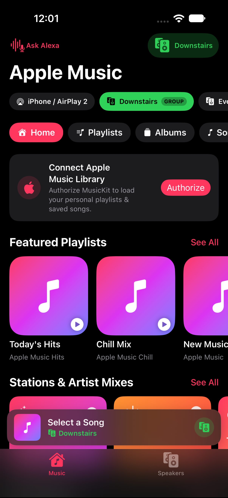
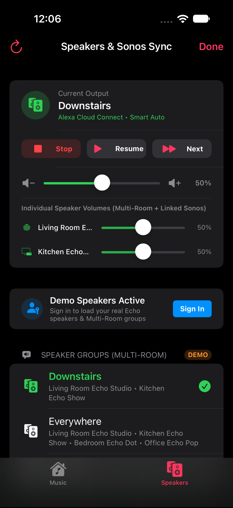
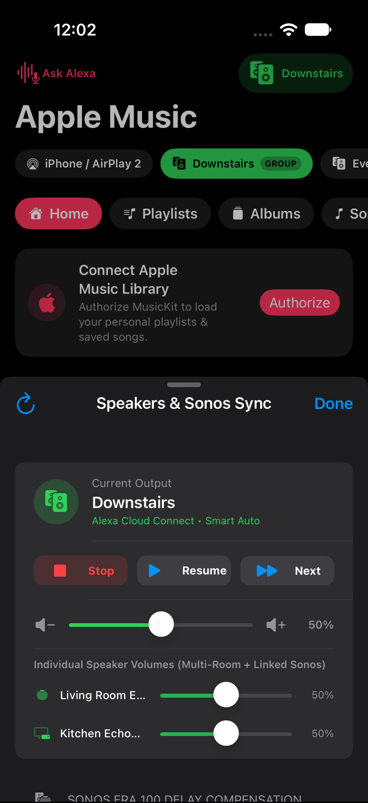
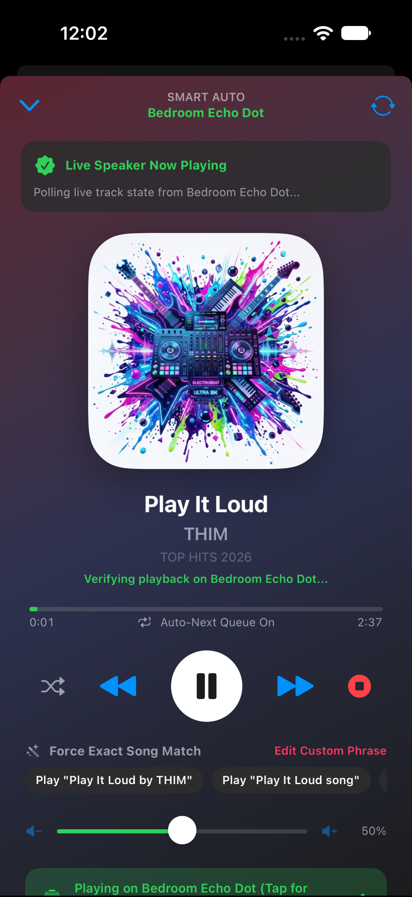

# EchoBridge for Apple Music, Alexa & Sonos 🎵🔊

> **A Spotify Connect-style speaker picker for Apple Music + Amazon Echo & Sonos.**
> Browse Apple Music, pick any individual Echo speaker, Sonos speaker, or Multi-Room group, and cast music directly from your iPhone—complete with **Sonos + Echo Multi-Room Sync & Delay Compensation**.


---

## 📱 App Screenshots

| Apple Music Browse & Quick Groups | Multi-Room Groups & Amazon Sign-In | Sonos Sync & Per-Room Volumes | Live Alexa Now Playing & Transport |
| :---: | :---: | :---: | :---: |
|  |  |  |  |

---

## 💡 The Story: Why Does This Project Exist?

If you use **Spotify** and own **Amazon Echo** speakers, life is easy: you open the Spotify app, tap the speaker icon, and every Echo device and Multi-Room speaker group in your home appears right there via **Spotify Connect**.

If you switch to **Apple Music**—and especially if you have a mix of **Amazon Echo** and **Sonos** speakers (like a **Sonos Era 100**)—you hit two massive walled-garden walls:

### Problem 1: Apple Music Has No "Spotify Connect" for Alexa
1. **Apple Music only speaks AirPlay 2** in its native speaker picker, and **Amazon Echo speakers don't support AirPlay**.
2. Even though Amazon has an official **Apple Music skill for Alexa**, the only ways to use it are shouting voice commands across the room (*"Alexa, play my Chill Mix playlist on the Downstairs group!"*—and hoping she understands the song title) or digging through the clunky Alexa app menus.
3. Worse, if you try to build a custom Alexa Skill using Amazon's `AudioPlayer` directive or an AirPlay bridge, **Amazon blocks custom skills from playing on Multi-Room Music (`WHA`) speaker groups**.

### Problem 2: The Sonos + Echo Multi-Room Sync Problem
If you own both **Amazon Echo** speakers and Alexa-enabled **Sonos** speakers (e.g., **Sonos Era 100**, Beam, Arc, One):
1. **Walled-Garden Multi-Room Groups**: Echo's Whole-Home Audio (`WHA`) protocol and Sonos's proprietary grouping don't natively merge—leaving your Sonos speaker excluded from your Echo *"Everywhere"* group, or vice versa.
2. **The ~1.8-Second Sonos Cloud Buffer Lag**: Even when you trigger Apple Music on both an Echo group and a Sonos Alexa speaker, **Sonos routes the stream through the Sonos Cloud buffering pipeline**, causing the Sonos speaker to start **~1.5s to 2.2s behind** your Echo speakers—creating a stadium-echo effect across your house.

---

## 🛠️ How We're Tackling Both Problems

Instead of trying to force raw AirPlay audio over a local network skill (which breaks Multi-Room sync), **Alexa Apple Music Connect** acts as a **smart cloud-to-cloud + hybrid AirPlay 2 controller** directly on your iPhone:

```
┌────────────────────────────────────────────────────────────────────┐
│                   Alexa Apple Music Connect (iOS)                  │
│                                                                    │
│  ┌──────────────────────────┐        ┌──────────────────────────┐  │
│  │     Apple MusicKit       │        │   Hybrid Sonos Bridge    │  │
│  │  • Personal Library      │        │  • Companion '+' Linking │  │
│  │  • Playlists & Albums    │        │  • +1.8s Head-Start Sync │  │
│  │  • Full Catalog Search   │        │  • AirPlay 2 Beat Nudge  │  │
│  └────────────┬─────────────┘        └────────────┬─────────────┘  │
│               └─────────────────┬─────────────────┘                │
│                                 ▼                                  │
│                  ┌─────────────────────────────┐                   │
│                  │     PlaybackCoordinator     │                   │
│                  │  Spotify Connect-style UI   │                   │
│                  └──────────────┬──────────────┘                   │
└─────────────────────────────────┼──────────────────────────────────┘
                                  │
         Direct HTTPS (Session Cookies + CSRF negotiated on-device)
                                  │
                                  ▼
┌────────────────────────────────────────────────────────────────────┐
│                    Amazon Alexa Cloud APIs                         │
│                                                                    │
│  1. Discovery: GET /api/devices-v2/device                          │
│     • Individual Echo & Sonos AVS Speakers (ECHO, KNIGHT, SONOS)   │
│     • Multi-Room Speaker Groups (deviceFamily == "WHA")            │
│                                                                    │
│  2. Staggered Multi-Room & Sonos Dispatch:                         │
│     • Step A: Trigger linked Sonos speaker FIRST (+1.8s head-start)│
│     • Step B: Trigger Echo 'Everywhere' WHA group on the exact beat│
│                                                                    │
│  3. Control:   POST /api/np/command & GET /api/np/player           │
│     • Per-Speaker Room Volumes, Play/Pause/Next/Prev & Live State  │
└────────────────────────────────────────────────────────────────────┘
```

1. **Discover Every Echo, Sonos AVS Speaker & Multi-Room Group**: Queries `/api/devices-v2/device` to list individual Echo speakers, Alexa-enabled Sonos speakers (`SONOS / AVS`), and `WHA` Multi-Room speaker groups—complete with the member speakers inside each group.
2. **Sonos Multi-Room Companion Linking (`+` Link)**: Tap `+` next to any Sonos speaker (like Sonos Era 100) to link it as a companion to your Echo Multi-Room groups. Whenever you play a track on *"Everywhere"* or *"Downstairs"*, your linked Sonos speaker automatically plays too.
3. **Sonos Head-Start Sync Offset (`-2.0s` to `+4.0s`)**: To eliminate the Sonos Cloud buffering lag, the app dispatches the playback command to your linked Sonos speaker **first** (e.g., `+1.8s` head-start), waits for Sonos to buffer, and then fires the Echo Multi-Room group so both ecosystems drop on the same beat.
4. **Hybrid AirPlay 2 + Alexa Dual-Play Bridge**: Prefer using native iOS AirPlay 2 for your Sonos Era 100 while your Echo speakers play via Alexa Multi-Room? Enable **Dual-Play** and use the **`-0.25s` / `+0.25s` Fine Beat Nudge** buttons to align local AirPlay 2 audio with your Echo group in real time.
5. **Per-Speaker Multi-Room Volume Sliders**: Adjust the volume of each individual Echo and linked Sonos speaker inside a group independently from a single card.

> *Built in the open and vibe-coded with **Gemini 4 Argon** in Antigravity—turning a daily smart-home frustration into an open-source community project.*

---

## ✨ Current Features

- **Spotify Connect-Style Speaker Picker (`SpeakerPickerSheet`)**:
  - View all **Speaker Groups (Multi-Room)** with their member Echo devices listed underneath.
  - View all **Individual Echo Speakers** with online/offline status and device-specific icons.
  - Switch speakers mid-song to immediately transfer playback to the new target.
- **Native Apple Music Browse & Search (`AppleMusicManager`)**:
  - Browse your personal Apple Music playlists and recently added tracks via `MusicKit`.
  - Search songs, albums, and playlists across the Apple Music catalog (with an automatic fallback to the public iTunes Search API so the app works immediately in the Simulator even before provisioning a paid MusicKit token).
- **1-Tap Native Music App Handoff**:
  - Detects what's currently playing in the iPhone's native Apple Music app and offers a one-tap **"Cast to Alexa"** banner.
- **Real-Time Transport & Volume Control**:
  - Play, pause, skip next/previous, toggle shuffle, and adjust speaker/group volume from the mini-player bar or full-screen Now Playing sheet.
- **Instant Demo Mode**:
  - Preview the full Spotify Connect UI with simulated Echo speakers and Multi-Room groups (*Everywhere*, *Downstairs*, *Upstairs*) before signing into Amazon.

---

## 🚀 Getting Started

### Prerequisites
- Xcode 16+ / iOS 17.0+
- An Amazon account with Echo devices and the **Apple Music skill** linked in the Alexa app (`Settings -> Music & Podcasts -> Apple Music`).
- *(Optional for personal library playlists)* An Apple Developer account with the **MusicKit** capability enabled on your App ID.

### Build & Run
1. Clone the repository:
   ```bash
   git clone https://github.com/Arjunm28/EchoBridge-for-Apple-Music-and-Alexa.git
   cd EchoBridge-for-Apple-Music-and-Alexa
   open AlexaAppleMusic.xcodeproj
   ```
2. In Xcode, select the **AlexaAppleMusic** project -> **Signing & Capabilities**:
   - Select your **Team** and set a unique **Bundle Identifier**.
   - *(Optional)* Click **+ Capability** and add **MusicKit**.
3. Press `Cmd + R` to run on your iPhone or Simulator.
4. Tap **Connect Alexa** -> **Sign in with Amazon** (or tap **Try Demo Speakers** to explore the UI first).

---

## 🗺️ Open-Source Roadmap (Help Wanted!)

We're actively looking for contributors! Here are the top areas where you can jump in:

- [ ] **Queue Management & Up Next**: Queue multiple Apple Music tracks sequentially and auto-advance or sync queue state with Alexa.
- [ ] **iOS Lock Screen & Control Center (`MPNowPlayingInfoCenter`)**: Expose active Alexa speaker playback to the iPhone Lock Screen, Dynamic Island, and hardware volume buttons when casting.
- [ ] **Share Sheet Extension ("Share from Apple Music -> Play on Alexa")**: An iOS Share Extension so users can tap `Share` inside the native Apple Music app and pick an Echo speaker or group directly without even switching apps.
- [ ] **macOS Menu Bar App Target**: Bring the same SwiftUI codebase to macOS as a lightweight menu bar speaker picker.
- [ ] **Amazon OAuth / Token Refresh Hardening**: Improve long-lived token refresh (`at-main` / FRC / device registration) so cookies never expire.
- [ ] **Dynamic Multi-Room Group Builder**: Create or modify speaker groups on the fly from inside the app.

Check out [CONTRIBUTING.md](CONTRIBUTING.md) to get started!

---

## 🔒 Privacy, Security & Disclaimer

- **On-Device Keychain Storage**: Your Amazon session tokens never leave your device and are stored encrypted in the iOS Keychain (`kSecClassGenericPassword`, `kSecAttrAccessibleAfterFirstUnlockThisDeviceOnly`). There are no analytics, telemetry, or external backend servers.
- **Unofficial API Notice**: Like Home Assistant's `alexa_media_player` and `alexapy`, this project communicates directly with Amazon's internal Alexa web endpoints for device discovery and Whole-Home Audio control. It is intended for personal/educational use and sideloading.
- **Non-Affiliation & Trademarks**: This project is an independent open-source utility and is **not** affiliated with, endorsed by, or sponsored by Apple Inc., Amazon.com, Inc., Sonos, Inc., or Spotify AB. *Apple Music*, *AirPlay*, *Amazon Alexa*, *Amazon Echo*, *Sonos*, and *Spotify Connect* are trademarks of their respective owners.

---

## 📄 License

This project is licensed under the [MIT License](LICENSE).
